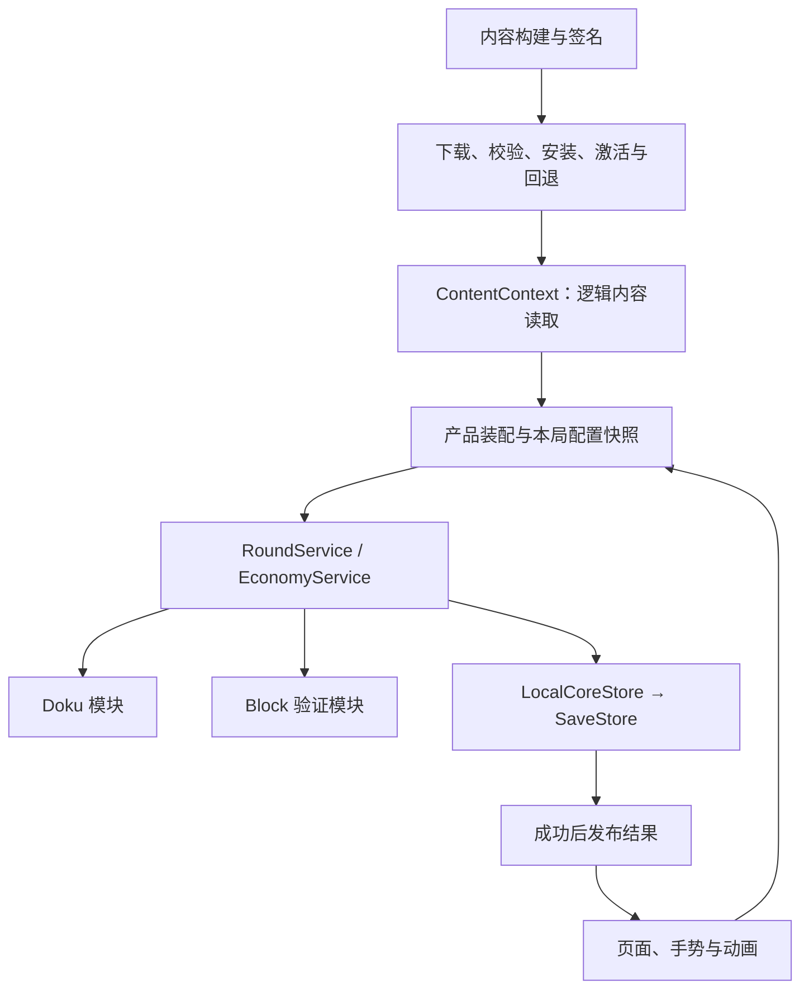

# 可复用玩法与内容交付：实施与验收记录

> 版本说明：本文保留 `d89f94d` 及此前框架实施／评估的历史记录。随后执行的 1.22 产品迁移、schema 2 和新验收结果见 [1.22 迁移记录](migration-1.22-report.md)；本文旧测试数量和接口描述不代表迁移后状态。
本文说明当前公共机制、产品接入和事务边界。学习与新产品接入先读 [框架使用指南](framework-usage.md)；命令范围与完整自动验证入口见 [工程说明](README.md#运行验收)。

公共层集中存储、窗口、内容交付和可选对局/奖励事务；Meowdoku 的资格、价格、选题、页面与数据模型属于产品。普通棋盘操作与关键消费仍有明确的兼容接缝，不宣称产品已经全面改成同一条宿主路径。默认生产 CDN、公钥和原生 SDK 仍需实际接入，桌面验证不代替真机验收。

最新归档结果由 [验收索引](validation/framework-report.json) 的 `current_acceptance` 指向。以下正文解释职责与合同；文末保留各轮历史验收摘要，旧数字和旧路径只代表当时的检查范围。

2026-10-30 的架构评估与暂缓决定见 [当前状态评估与暂缓事项](current-state-and-deferred-work.md)。其中单独列出尚未修复的恢复缺口、条件性安全风险和未验环境；本页的历史通过记录不表示这些事项已经解决。

## 1. 基线与运行环境

- 原恢复基线：`7af200ca1b582a86c92ab3d498c6af43a20d201a`。历史恢复报告中的源码同一性结论针对该基线，不适用于这次主动重构后的文件。
- 重构成果已在 `refactor/product-framework` 分支提交为 `d89f94d`；原恢复基线仍为 `7af200c`。用户原有 `.gitignore` 规则保留，提交整理时补充了 Python 缓存忽略规则。
- 验证引擎：`4.6.1.stable.custom_build.14d19694e`，本机 `/opt/homebrew/bin/godot-4.6.1`，包含 Spine。
- 业务验证使用临时工程副本；只在副本中将 `user://` 重定向到临时目录。每个测试进程使用独立临时存档，原有玩家数据不参与迁移试验。
- Android preset 排除 `tools/**` 与 `docs/**`，显式包含产品 JSON 与指定公钥文件。原生模板路径保留原配置；本机缺少对应 Android 模板，本轮未导出完整 APK。

## 2. 最终架构



共享层负责内容交付、持久化、库存事务、对局身份、请求重试和窗口机制；玩法负责自己的模型、动作、规则及专属产品用例；应用负责启动装配、整份产品数据、平台与跨玩法产品功能；页面负责意图、提示和表现。Doku 的难度、选题与结算政策跟随 Doku 维护，不因它属于产品规则就另建一套镜像目录。没有引入本地 HTTP 业务服务器，也没有要求不同玩法共用 Doku 棋盘或 BaseGamePage。

| 层 | 位置 | 已实现内容 |
|---|---|---|
| 内容交付 | `scripts/framework/content/` | 签名频道与清单、兼容选择、下载重试/进度/取消、逐文件校验、不可变安装、试启动回退、安全缓存维护 |
| 启动与读取 | `products/meowdoku/app/bootstrap/`、`scripts/framework/content/` | 产品启动装配、通用 ContentContext、数据与媒体版本分离 |
| 存档 | `scripts/framework/storage/` | SaveStore 文件双槽、LocalCoreStore 候选校验与 revision 提交，失败不发布 |
| 通用业务 | `scripts/framework/application/` | RoundService 与 EconomyService |
| Doku | `products/meowdoku/gameplay/` | 独立棋盘、输入/草稿/自动动作规则、提示与工具、对局模块、固定关卡表与跨表校验 |
| Doku 产品用例 | `products/meowdoku/gameplay/application/` | 选题、冻结策略、残局兼容、产品结算与复活事务 |
| 应用装配与产品数据 | `products/meowdoku/app/` | 旧档迁移、核心 schema、GameState 门面、平台、产品功能与路由 |
| 通用窗口 | `scripts/framework/ui/` | 无产品 Autoload 的窗口生命周期、缓存、异步预热、层级、输入顺序和遮罩 |
| 第二玩法验证 | `scripts/examples/block/domain/`、`scripts/examples/block/` | 独立可交互页面、拖放预览、清行计分、恢复、奖励去重与旧拖拽拒绝 |
| 玩法表现 | `products/meowdoku/gameplay/presentation/` | 主线/每日/教程/结果页面、输入、棋盘与资源消费者 |

目录迁移保留 class_name、UID、Autoload 名称与顺序、存档格式、逻辑页面名和资源槽合同。原 `module/products/bootstrap/common/core` 已分别归入上述职责，不留旧路径桥接实现。恢复验证使用 `recovered_relocations.json` 的显式原身份映射，同时检测不存在的身份、目标缺失和目标碰撞；原 257 个脚本与 74 个场景的恢复身份仍完整检查。

核心操作共用 `OperationResult` 的 `ok/error/detail/cause` 约定，旧 `status` 保留。Meowdoku 的结算计算集中到 `MeowdokuRoundSettlement`，GameState 只协调候选、提交和提交后通知。RoundSession 接受 Object 方法端口，可由 RefCounted 内存适配器运行。冻结关卡定义的结算只依赖纯 `DokuLevelDefinition`，无需当前内容或页面环境。

公共 `UIWindowManager` 持有窗口机制，产品 `UIManager` 只装配路由、声音、资源准备和安全区；Tracker 在 UITrackerObserver 旁听。窗口通过两个可选 Callable 接入声音与场景准备，默认关闭通过信号返回所属管理器。这些接缝无需依赖注入容器或新服务定位器。

页面入口继续做局部整理：GamePage 用同文件方法明确复位、搭盘和选题提交，残局恢复的参数映射与恢复决策分开；DailyGamePage 独立出选题准备。异步布局等待与代次检查保留在各自 `on_show()`，未增加页面控制器或流程框架。基类的冻结配置和会话声明集中到状态区，方便区分页面代次、持久对局身份与棋盘活状态。

## 3. 内容交付：已经完成的闭环

1. 构建工具生成 JSON / 原始媒体 / 受限 Spine PCK 发布物，在签名前验证产品 schema、跨表引用与媒体合同；外部私钥签名，私钥不进入客户端。频道签名绑定具体 runtime、release 与清单哈希。
2. 客户端在临时目录下载，验证公钥签名、产品与运行时合同、大小、哈希、路径及产品数据结构。
3. 验证成功后安装为不可变版本，登记候选；下载回调不改变正在玩的棋盘。
4. JSON 在新局入口激活；PCK 在其他 Autoload 读取内容之前冷启动挂载。当前局保存题面、规则和实际题源。
5. 数据与媒体分别记录活动版本，JSON-only 更新可继承当前媒体。数据版本本身相对于内置内容覆盖，不自动叠加上一份远端 JSON。
6. PCK 启动先记录 trial，关键入口正常后确认；挂载后失败要求重启，下次进程回退。不能假装在已挂载进程卸载了资源包。
7. 题库、选题策略、SoundManager、主页猫爪及登记的主页/棋盘图片和 Spine 已接入真实消费者。固定关卡表可明确指定题目、预填、初始生命、草稿解锁、资源别名与通关奖励。场景结构和脚本仍随客户端发布。
8. 固定场景图片检查像素尺寸，Spine 检查原动画/皮肤名称；发布和冷启动都校验。新增槽位需要客户端登记，不能用任意远端路径覆盖脚本或基包。
9. 下载有有限重试、进度和取消；匹配已安装清单时跳过载荷。启动及更新维护保护被引用的版本，清理中断残留和安全可删除版本。

当前产品采用静默后台更新，进度和取消仅作为程序接口。通用配置链路已使用超过 1 MiB 的非关卡 JSON 验证；产品 validator 按实际消费者区分普通/GC 题库格式，并以与运行时相同的策略合并结果检查跨表引用。逐关媒体只允许棋盘实际消费的槽位，首页等资源仍由全局媒体映射配置。

真实导出实验确认了 Godot UID 的全局影响：只做版本目录隔离或“每进程一代”不足以保护内置资源。当前发布工具过滤全局 UID 缓存，并验证导入依赖闭包与路径冲突；保留相应回归试验。

默认 `public_key_path`、`channel_url` 与 `release_url` 为空，正常启动继续使用内置内容。`check_for_updates()` 已能通过签名频道发现适配当前 runtime 的版本；频道 revision 防止旧入口回放，正式内容回退通过更高 revision 指向旧 release。保留给定不可变地址的 `download_and_stage()`。用户分群与远端 A/B 分配服务没有新增；既有规则 AB 在本局冻结。生产域名、公钥与发布账号需要实际环境配置。具体命令和限制见 [内容交付文档](content-delivery.md)。

## 4. 业务分离：实际流程如何变化

| 流程 | 当前提交边界 |
|---|---|
| 开始主线 | 先在副本选题，棋盘准备成功后，一次提交游标、当日资格、重试参数、初始残局、新局 ID 和统计清零 |
| 每日入场 | 两次布局完成后提交；NEW 的日期、身份、统计与策略一起保存，失败或取消保留旧状态 |
| 自动标叉与教程完成 | 资格和权益单笔保存；广告回奖写失败可直接重试；教程完成标记保存成功才进入首局 |
| 提示 | 每次重新打开成功时，将扣费与新提示凭证同时提交；同盘面再次打开也收费，应用不再扣费 |
| 定位与撤销 | 定位按次使用收费，包括空候选；撤销无可选步骤不收费，选中步骤即使没有格值变化也消费并移除历史。库存、棋盘与历史仍同次提交 |
| 主线/每日/预览结束 | 检查 round/attempt 与真实胜利盘面，按本局冻结 DDA 提交进度和残局；固定关卡奖励同笔入账，重复结算不重复推进 |
| 赠命 | 新生命、局内已用标记、首次赠送资格和可恢复棋盘一起提交，失败不消耗资格 |
| 复活 | 生命、尝试序号、免费一次资格和残局一起提交；写失败不先关闭失败页或改变生命显示 |
| 签到与切组礼包 | 领取资格与稳定奖励流水共同提交；重试不重复登记 |
| 普通/翻倍奖励 | 队列移除与全部道具入账一次提交；保存失败不宣布成功，奖励页保留重试 |
| 全量重置 | 写成功才发布重置并清会话缓存；保留发号水位，旧局回调不能复用身份修改新状态 |
| 终局写失败 | 暂停操作并明确重试/退出；重试冻结时长和每日成绩，复活后计时恢复 |
| 通关后签到 | 两次明确提交；签到失败单独重试/跳过，不能重放已保存的通关进度 |

旧数据首次读取迁入新核心存档，迁移不改写旧文件，新业务不再同时写多份旧业务档。损坏、未知格式和首次安装是不同状态；不能用默认值悄悄覆盖未知档。详细提交点与失败语义见 [本地业务文档](local-business.md)。

点按/拖动、草稿、自动排叉/完成的规则已抽为无副作用计划，输入适配器与独立对局模块共用；识别手势、动画时序和产品流程仍由输入方案/页面负责。普通手势合并历史并保存检查点，关键消费和奖励即时提交，不为每一格动画写整份存档。失败检查点保留活棋盘并有限重试，每次重试重新捕获最新状态；旧代次回调拒绝写入。这个本地活状态同步接口不能当作服务器权威协议。详见 [玩法模块文档](gameplay-modules.md)。

## 5. 复用证明与主动修复

Block Probe 具有与 Doku 不同的状态及动作，通过同一个未修改的 RoundService 和真实 LocalCoreStore，完成合法/非法放置、消行消列、分数保存、跨实例恢复和一次性结算。另有可运行的独立 Block 页面，包含拖放、预览、新局、读取和领取，证明规则、产品装配、存储和视图可以独立于 Meowdoku。它不是完整 Block 产品，也没有实现交换三消的连锁演出。运行方式见 [框架使用指南](framework-usage.md)。

业务与窗口也分别有最小工程：只复制声明的依赖，不带产品 Autoload。业务验证真实 Session 的失败重试、恢复、提示、快照镜像和纯结算；窗口验证多个管理器归属、根窗/子窗回调、缓存、预热、遮罩、绘制与真实鼠标输入。显式资源依赖守卫纳入 `--suite framework`，阻止公共层引用产品、纯规则引用页面或玩法相互引用；它不代替运行时验证。

这次有意修复了原实现中的失败窗口，而非复制缺陷：

- 存档提交标记失败不会使已完成正式替换的最新档丢失。
- 多种道具奖励不再可能只入账一部分、却已从待领取队列移除。
- 提示凭证和扣费一起保存；根据用户要求恢复原版按次打开收费，同一请求重试仍幂等。
- 定位恢复原版空候选收费；撤销保留无可选步骤不收费及已有的受保护格约束。
- 复活不再提前消费免费资格、改变 UI 后才尝试存档。
- 页面关键异步回调有代次防护，重复业务回执使用静态恢复，不重播消费和历史副作用。
- 奖励保存失败保留页面；翻倍回调之后的 SDK close 不会将待重试的翻倍意图降为普通奖励。
- 奖励页重复展示时通过 UI 托管接口清理子窗口，避免保留已释放对象。
- 每日及主线的打卡等待、每日两次布局等待和主线广告后入场检查当前代次；非法每日题在旋转前拒绝，整池无合法题时不进入对局。
- UI 异步预热不会覆盖或隐藏已显示实例；旧关闭不会提前移除新显示的页面、遮罩或埋点来源。
- 固定发布地址与频道一致隔离失败版本；局间发现坏候选后保留活动内容，安装前取消不会继续写入发布物。

## 6. 验收证据

此前完整复核中，共38个自包含脚本、工程导入及600帧启动通过，共40步骤。机器可读记录见 [验证结果](validation/framework-report.json)。该次验收记录了733份源码、UID、场景、工具和配置指纹，其中730份与最终隔离工程逐文件核对一致；随后仅修正发布报告汇总及其Python回归两份工具文件，重新通过19项Python测试和14项实际发布用例；export_presets.cfg 仅记录指纹，未据此宣称移动端构建通过。报告保留历史验收，并单独列出本轮完整 suite、独立工程、内容工具和发布拒绝验证。

此前针对返回键、故障恢复按钮和开发隔离的定向验证记录在 [历史报告](validation/development-ui-report.json)。后续各轮分别执行完整47、49、53步骤；恢复原版计费后为完整54步骤，最新证据见本文开头。下表汇总各轮证据，独立专项的执行轮次以前述报告为准；模拟构建分支不等于实际release导出。

| 验证 | 结果与意义 |
|---|---|
| 原恢复验收 | 257 脚本、74 场景、75 翻译、26 题库、20,746 记录、20,710 答案项通过结构验收；63 条原始非法答案仍由运行时拒绝 |
| 存储故障注入 | 100 项断言通过：旧格式、双槽、损坏、未知格式、提交前后失败、重启选择及公开结果诊断；另有候选隔离65项 |
| 产品业务 | 105 项断言通过：迁移、资格、整笔奖励、重复回调、结算、复活身份与重置失败 |
| 设置与待合并统计 | 142 项断言通过：连续写失败、独立库存提交、重试保存、四项开关、语言确认、缓存页面刷新、规范字段重置及非默认分区映射往返 |
| 独立产品结算 | 15 项断言通过：不经页面/Autoload/文件调用，候选进度奖励、冻结策略、重复结算、每日与旧残局兼容 |
| 独立产品会话 | 36项：RefCounted 产品端口、写失败与重试、恢复后再次购买提示、快照镜像，以及同步提交中的旧回执、后续动作和序号耗尽；与结算共51项在无Autoload最小工程通过 |
| 通知、断签与重置 | 新增63项：库存嵌套通知、断签保存失败、日切冷却、主动重试、切组资格和重置运行时缓存 |
| 终局及后续签到恢复 | 64项：主线/每日胜负写失败、连续重试、退出、旧回调、复活计时、统计与成绩冻结，以及胜利后签到独立重试、真实法语/日语按钮翻译 |
| 真实弹窗与教学 | 59项：评分/反馈/确认重复点击与旧动画、取消等待、切组礼包失败、完整check/IQ教学与旧演出隔离、Escape/Android返回入口 |
| 权益、教程与重入 | 新增48项：免费资格与权益、真实Mock广告回奖失败重试、过期回调、教程失败重试与同步通知统计 |
| 补发页面 | 新增27项：旧动画/批次隔离、首页互斥监听清理、外部关闭、写失败重试和队列恢复 |
| 真实奖励页 | 19 项断言通过：按钮、失败留页、翻倍回调、SDK close、重试成功和迟到回调 |
| 广告逐次身份 | 63项：A/B乱序、重复、未知、清档、补发登记竞争、保存重入、重试新增流水、真实页面同帧销毁，以及旧桥降级/插屏兼容；并非原生SDK验收 |
| 真实页面连续广告 | 567项：主线/每日道具、乱序/重复回奖、页面生命周期、3/5笔复活重入、连续保存失败后免广告重试、后续定位和再次失败复活、每日遮挡、同步退场回调，以及缓存每日页广告时长扣除 |
| Doku 模型/视图/规则 | 唯一活状态、输入/草稿/自动规则、赠命事务、策略冻结、提示与工具通过；新增动作/策略/失败页 88 项断言 |
| 选题 | 解析不写盘、固定种子、一次提交、重试复用、当日降档与冲突检查通过；新增长筛选/旋转/LK-only 18项 |
| 主线选题独立期望 | 32项：历史困难档随机、连续顶档限制、降档前的顶档记录、单值区间与跨分支 RNG 消耗顺序；固定 Godot 4.6.1 的历史结果 |
| 入场失败与取消 | 104 项断言通过：主线/每日内容失败、两次布局等待中取消、保存失败、保留旧题/资格/身份/统计、恢复标记和首次每日重试；选题回归另验无检查点的新题清旧快照 |
| 实际对局页面 | 52 项用例断言通过，包括主线/每日提示关闭重开分别收费；另有原版道具收费边界67项，覆盖空定位、无变化撤销、免费、广告补充及失败重试 |
| 内容消费者 | 2700 次原尺寸决策对照、真实题库/策略切代、36 项题源/GC/元数据检查、22项真实SP预填/坏缓存/旧参数检查及音频/纹理消费者通过 |
| 内容交付工具 | 基础交付 51 项、频道/更新 48 项、真实启动器 8 项及第二进程离线恢复 4 项；挂载失败下次回退通过 |
| 真 PCK 与 Spine | 真实导出、加载、UID 碰撞防护、JSON 切代继承媒体及重启恢复通过 |
| 宿主和第二玩法 | 模块合同 71 项、交互 Block 21 项、存储性能/有界性 133 项；实际产品检查点与奖励/DDA 24 项通过 |
| 固定关卡与资源 | 精确引用、真实入口/恢复及目录缓存91项；合法省略尺寸和搭盘失败37项；题池消费者合同78项；此前真实产品发布合同22例 |
| 教程内容边界 | 实际教程21项：无 guide/异尺寸 guide、完整七步与正式开局；真实签名试启动及 launcher 故障回退9项 |
| 页面生命周期 | 主线/每日43项、UI重入、预热与遮罩35项；正常流程和过期回调拒绝均通过 |
| 独立窗口框架 | 最小工程239项、产品工程238项：声音/资源回调、关闭归属、层级与真实GUI点击、遮罩交接、同步重开、批量隐藏、外部释放及创建过程同步取消/重入 |
| UI 组件 | 74项：弹窗队列同步关闭、异步取消和销毁交接，语言页重复刷新及缓存重开，字号组首帧布局与尺寸变化 |
| 恢复提示本地化 | 671项：75个locale的消息键及五种语言真实失败界面；另以相同翻译注册配置导出PCK并通过450项加载检查，未替代人工译审 |
| 安全区 | 53项：真实0.5/2倍视口、父缩放、窗口位置/黑边、双边与零inset、6个真实页面及容器重排；系统矩形为受控输入 |
| 隔离启动 | 全工程编辑器导入与 600 帧启动 smoke 通过；没有脚本解析或断言失败 |

运行全部自包含回归和启动 smoke：

```sh
python3 tools/run_validation.py --suite framework --smoke
```

其他规则和内容工具的命令分别在三份专题文档中。运行器保留临时日志和 `report.json`，检测进程退出码、脚本解析错误、断言失败及未知引擎 `ERROR`。Python工具回归24项覆盖退出码0仍有栈错误、资源加载失败、窄例外条件，以及实际发布命令的错误拒绝、重跑报告汇总、套件分类和开发服务的运行分支。共享门禁已接入交付、Spine、签名前产品验证、原始PCK和Block独立工具。隔离导入不再复制旧类名/UID索引，按当前源码重建。前轮仅凭旧门禁的通过结论不能作为日志无异常的证据，以本轮新门禁重跑为准。故障注入会有预期错误日志；当前 macOS 沙箱的证书/编辑器设置告警，以及强制退出时的既有资源释放告警，不冒充为已解决的原生环境问题。

## 7. 明确的交付边界

- 仓库没有生产 CDN、私钥、公钥或运营账号；发布工具、签名频道发现和客户端能力已建好，生产地址及实际上线未配置。
- 本轮验证为 macOS 定制引擎 headless。原生广告、目标平台 TLS/导入、真机触控、后台杀进程和完整 Android/iOS 包尚未验收。
- 激励桥须提供带show_id的shown/rewarded/closed/error信号；仅有placement的旧桥返回不可用。仓库已验证Mock与桥合同夹具，没有实现外部原生插件，也没有跨进程展示凭证。本地幂等不等于SDK事件永不丢失或恰好一次。
- 本地文件提交是单进程写入协议；不承诺所有硬件断电情况下的绝对持久性，也未实现跨设备合并、多人同步或服务器防作弊。
- 资源更新不包含新玩法脚本；替换玩法时仍需实现相应规则、内容 schema、产品装配和视图，继续沿用已验证的公共基础设施。

这些是当前能力的适用范围。后续扩展应以实际玩法或平台需求增加模块，不能把尚未实现的能力算入本轮结果。


## 8. 有边界的排查与收尾方法

历次沿同一方法维护[收尾清单](validation/closeout-checklist.json)、[第一轮扩展清单](validation/expanded-audit-checklist.json)和[当前扩展清单](validation/extended-flows-checklist.json)。范围是已有功能的正确性与恢复能力，保留用户指定的原版玩法和收费；不把代码热更、后台服务、额外玩法、通用化重构或外部发布配置加入缺陷清单。

### 8.1 以合同和完整流程组织检查

每条流程先回答五件事：谁发起请求、谁持有状态、何时提交、何时通知/表现、失败或离页后由谁恢复。代码目录不是验收单位；一个奖励可能穿过广告桥、页面、奖励服务、存储和重试队列，必须按这条完整调用链检查。

| 不变量 | 需要验证的结果 | 本轮代表路径 |
| --- | --- | --- |
| 保存前不发布 | 保存失败不消费资格、不假装成功；恢复后有可执行重试 | 广告奖励登记与领取、终局重试 |
| 同一事实只生效一次 | 重复/乱序回执不重复发奖、扣费、计数或创建历史 | show_id、奖励 uid、结算回执 |
| 身份与时效一致 | 旧页面、旧局、旧尝试不能修改新状态；旧清理不能释放新请求 | 页面代次、对局 ID、复活尝试序号 |
| 生命周期语义清晰 | 遮挡不等于离页；关闭、重开、销毁都不能留下旧等待 | 解锁计时、Setting 关闭、窗口遮挡 |
| 消费合同一致 | 发布校验接受的可选字段，消费者也必须接受 | regionMap 推断尺寸、LK 改造题筛选与预览 |
| 产品行为不漂移 | 修复不改变原版收费、空目标行为与已有资格副作用 | 付费道具、has_used_tool、广告只补库存 |

检查矩阵采用风险驱动：正常成功、保存失败与恢复、重复/乱序、同步重入、隐藏/遮挡/销毁、同页重开/新局、合法缺省内容、恢复后的下一次操作。不是把所有维度机械地做笛卡尔积；优先覆盖状态变更与外部回调相遇的边界。

### 8.2 证据、横向检查与最小修复

1. 固定源码基线和已知问题；报告中的“已复现”“明确调用链缺陷”“潜在风险”“待环境验收”分别记录。
2. 用真实页面、真实服务与隔离存档复现。故障注入尽量绑定登记、领取等业务阶段，避免只写“第 N 次保存失败”。
3. 每发现一种遗漏，都查询其他同类消费者或回调；记录哪些需要修、哪些已有保护及理由。一个复现函数通过不代表该类缺陷已经收尾。
4. 优先在已有职责边界修复。先形成可失败的回归，再验证修复；可行时在临时副本撤去修复，确认同一测试确实能抓住原缺陷。
5. 独立交叉审查正常行为与失败路径，再跑相邻回归。交叉审查发现的次生边界回到同一清单，不新开一个没有终点的“再优化”计划。

### 8.3 验收与停止条件

已确认缺陷须有对应回归、同类入口须有结论、原版行为保护须通过。实现稳定后冻结源码，执行完整自包含套件与 600 帧启动检查；修改了独立边界或测试工具时，同时跑对应独立工程和工具测试。最后核对测试副本与交付工作区的源码/配置指纹，防止把修改前的通过结果当成修改后的验收。

满足上述条件后结束本轮。尚未证明的性能担忧、无需求的抽象整理不阻止收尾。退出资源告警和外部环境未验收也不会被隐去或改称“全部无问题”；它们单独保留证据与验证条件。后续仅由真实缺陷证据、实际需求变化或目标环境结果触发新工作。测试覆盖给出的是可核对的保证范围，不是数学意义的零缺陷证明。


### 8.4 扩展范围后的实际执行结果

声明范围不是不能继续检查的限制。本轮沿四条完整流程扩大覆盖，并将交叉审查发现的问题纳入同一清单：

| 扩展流程 | 已修复结果 | 触发条件与边界 |
| --- | --- | --- |
| 下载完成 → 暂存 → 激活/确认 → 清理 | 新版本不会在暂存登记之前被清理 | 公开进度回调同步激活/确认；默认静默监听不触发此路径 |
| 旧档/坏槽 → 恢复 → 清档/结算 → 连续保存 | 拒绝非法迁移数据；已知坏快照可回退；保持文件序号水位；清档后的旧结果不能回填会话资格 | 未知 schema/格式仍整体拒绝。只恢复可验证旧快照，不推测坏槽奖励；最后不可验证提交可能丢失 |
| 奖励/签到/隐私/ATT → 回调 → 同页刷新/关闭 | 旧领取、翻倍、动画和完成回调不再影响新展示 | 缓存页面的重复 `on_show` 有自身展示代次；不改变通用窗口展示合同或引入额外状态框架 |
| 手势/轴按钮 → 多格动作/演出 → 重开/销毁 | 旧批次停止通知、历史与统计；按钮遵守既有操作限制；临时锁、遮罩、静音及等待对象正确释放 | 正常收费与棋盘规则保留；初始化预填可继续执行；实际按钮和调试入口都覆盖 |

资源释放先定位再修改。自动完成的重复销毁原来同时积累外置策略浮层和等待状态；五类标叉等待也逐次留下计时对象。修复沿用页面已有的托管 Timer，并移走被取消协程持有的匿名 Callable。重复采样修复后保持稳定；五类演出的正常完成、原地刷新、隐藏重开共 145 条临时专项断言通过，最终常驻回归为 129 条。该脚本的资源或 ObjectDB 退出告警会使门禁失败，不能被当作历史观察项放过。

Ogg 退出告警另做对照：原 `test_game_page_lifecycle` 退出时入场音效只播到约 0.467/1.057 秒，额外等自然结束后告警消失；实际音效重复播放 12 次、背景音乐启停 20 次的对象、资源和节点采样稳定。这支持“所测告警发生于播放未完成时退出”，不支持把它说成持续运行泄漏；也不据此宣称所有音频、其他退出步骤或移动端均无问题。原测试诊断仍保留。

存档恢复校验有实际成本：12 次合成档采样中，约 14 KB、229 KB、918 KB 的桌面同步提交 p50 分别约 1.61、19.32、78.15 ms，最大档 p95 约 78.62 ms。它不是移动性能保证；本轮没有为降低这项数值削弱事务校验或添加缓存框架。后续若真实存档增长，依据实测调整规模和保存频率。


### 8.5 真实输入、会话及端口的进一步扩展（2026-10-29）

本轮在原验收指纹完全一致的基线上继续扩展。新增检查不以“必须发现问题”为目标：逐项写出预期合同，真实事件或文件复现后才修；符合原合同的实现保留。

| 流程 | 修复与验证 |
| --- | --- |
| 按下 → 移动 → 遮挡/失焦/取消 → 下一次操作 | 移动交给真实 GUI 捕获链并检查当前输入归属；取消时保留已落下的笔画，清理按压/双击状态。修复左/上盘外负坐标误入第0格。覆盖盘外拖回、普通/防误滑、草稿/撤销、主次触点模拟及两个终局的历史/计步/保存 |
| 前台时间 → 采集 → 保存/失败 → 后台/清档 | 焦点切换幂等；失败秒数待重试；重入不重复保存；成功清档撤销旧计时。提交期间读取既不双计，也不在失败通知内短暂回退；只读投影限定本地日期 |
| Block 新局/落块/领奖 → 提交通知 → 切局/切档 | 会话接受结果时核对来源及单调序号；重开失败清除旧宿主；恢复拒绝终态与棋盘/队列矛盾的快照。实际拖放取消、保存失败后重拖和旧拖拽拒绝通过 |
| 首页转场/启动收尾 → 同步回调 → 取消/刷新 | 旧转场计时器和动画失效；被取消的目标不会令首页不可用。旧启动补间不完成新展示；同步完成、隐藏、刷新或销毁均能结束启动等待 |
| 多个音效 → BGM 暂停 → 自然结束/stop | 按音效播放器独立持有暂停。提前结束一个音效不会解除另一个；停止最后一个不会留下永久暂停；对话框/广告暂停与原播放进度继续保持 |

无须改动的结论也保留证据：本地日期、公历闰年与跨月/跨年、每日入口心跳及缓存刷新通过 45 项；RoundService/EconomyService 候选失败后丢弃的既有合同通过 53 项；Block 拖放表现无需另写一套输入框架。

声音验证中的一个假设被撤销：本机定制 Godot 4.6.1 的播放器暂停时 `playing` 为 false，但仍有 `has_stream_playback()`。额外改写续播判断会重置已有暂停流，因此最终保留原续播逻辑，并以播放对象身份检查保护进度；最初“音乐开关后不恢复”的症状归因于残留的音效暂停，不另算开关缺陷。

同一份最终回归配回旧实现，导航 26 项中 16 项失败，音频 13 项中 4 项失败，会话 60 项中 26 项失败，Block 56 项中 21 项失败；输入反证及所有正常路径详见最新报告。测试夹具的 Autoload 预载错误已修正，未计入产品问题。真实 Viewport 事件和触摸到鼠标的引擎模拟提供了输入路由证据，仍不能代替移动设备触控、系统后台或原生 SDK 验收。


## 历史验收摘要

**当前最新验收（2026-10-29）：显式产品目录迁移已应用。** Meowdoku 的应用、玩法、编辑工具、资源与启动场景统一归入 `products/meowdoku/`，公共框架保持 `scripts/framework/`，Block 验证规则归入独立示例。全过程先在隔离副本验证，再核对工作区基线并应用。详见 [迁移计划](product-layout-migration-plan.md) 与 [迁移验收报告](validation/product-layout-migration-report.json)。完整回归为 75 步：两阶段冷导入、原有 72 个自包含脚本和启动检查；新增的一步是资源导入准备，不是新增业务测试。内容交付、产品发布、Spine、PCK 与实际产品导出包也重新验证。

2026-10-29 后续完成公共框架的第二阶段接入整理：产品专属控件归位、所有权说明、可执行接入示例及完整公共目录隔离验收。见 [接入验收报告](validation/framework-onboarding-report.json) 与 [使用指南](framework-usage.md)。这次是基于下述完整回归基线的定向验证，没有重跑或重新声明全部 74 步，也没有新增多产品平台。

当前已落地的两条基础能力：**签名内容交付**和**独立于页面的核心业务提交**。它们已经接入原游戏的真实读取、道具、奖励与结算流程，并用一个不同规则的 Block 模块验证宿主复用。后续审计仍发现并修复了消费者合同和生命周期遗漏；本文的通过记录只对应列出的用例，不代表所有功能已经穷尽验证，也不把桌面测试等同于移动端上线验收。

2026-10-29 继续扩展到真实输入中断、前后台会话计时、通用业务端口与 Block 使用链，以及首页/启动/声音控制，完成 7 组确认问题的修复。冻结后的 **74 步（72 个自包含测试、导入、600 帧启动）全部通过**；独立业务 51 条、无产品 Autoload 的 Block 页面 21 条、Python 24 项通过。990 份源码/配置登记指纹，其中 989 份与成功测试副本一致；`export_presets.cfg` 未执行导出。逐项结论见[进一步扩展清单](validation/extended-flows-checklist.json)，完整证据见[最新验收报告](validation/extended-flows-report.json)。本轮未改签名/HTTP/PCK 交付及纯窗口框架，相关独立专项明确沿用上轮同实现证据。

2026-10-28 的扩展检查覆盖内容安装与激活清理、坏存档恢复与清档发布、奖励/签到/启动页面、连续棋盘操作及演出资源释放，完成 12 类有证据的问题修复（包含交叉审查发现的恢复后保存边界）。冻结后的 **67 步（65 个自包含测试、导入、600 帧启动）全部通过**；独立 UI 260 条、独立业务 51 条、Python 24 项通过，内容交付 8 步、产品发布 22 例及 Spine 两进程专项也通过。976 份源码/配置登记指纹，其中 975 份与验收副本一致，`export_presets.cfg` 仅登记未导出；没有未解释的引擎错误。新销毁专项 129 条断言通过且退出干净；既有退出告警及本轮音频归因单独保留。方法见第 8 节，逐项结论见[扩展清单](validation/expanded-audit-checklist.json)，完整证据见[扩展验收报告](validation/expanded-audit-report.json)。

前轮按固定清单完成七类缺陷及其同类入口修复：正常广告奖励写失败恢复、终局发布重入、道具消费资格标记、预警与错标/草稿反馈计时、LK 可选尺寸消费、设置页关闭和窗口遮挡重入。冻结后的 **61 步（59 个自包含测试、导入、600 帧启动）全部通过**；独立 UI 260 条、独立业务 51 条、Python 23 项通过。964 份源码/配置已登记指纹，其中 963 份与验收副本一致，`export_presets.cfg` 仅登记而未执行导出。0 条未解释引擎错误；6 步仍保留退出资源告警。方法见第 8 节，逐项结论见[收尾清单](validation/closeout-checklist.json)，完整证据见[最终报告](validation/closeout-report.json)。

按用户要求，道具计费已恢复原版边界：提示每次重新打开成功都收费，定位没有候选也收费；撤销没有可选步骤本来就不收费，选中但格值未变的步骤仍消费并移除历史。存档事务、同请求去重与真实写失败保护继续保留。该次恢复的完整隔离54步及独立业务51项通过；处理依据和验证见[原版计费恢复记录](validation/original-tool-costs-report.json)与[逐项决定](framework-next-pass.md)。

上一轮修复了候选活数据别名、合法省略尺寸后的页面消费、创建重入、弹窗队列取消、语言重复连接及字号重算。广告已回奖但复活保存失败时可免广告重试；恢复提示改用原生翻译资源，目录按内容代次缓存。该轮完整53步套件、独立UI239项、独立业务47项、Python23项和翻译PCK加载450项的证据保留在[报告](validation/contract-fixes-report.json)。退出资源告警、母语译审、原生桥和目标平台验收仍分别记录，不由桌面业务测试替代。

此前同次失败复活串行与会话序号修复见[前轮报告](validation/revive-serialization-report.json)；连续广告、每日计时及选题固定期望见[更早报告](validation/ad-page-fixes-report.json)。该历史轮次的签名内容交付8步、真实产品发布22例及Spine专项沿用[当时证据](validation/review-followup-report.json)；本轮扩展检查已重新执行相关专项。该次结果发布修复的独立UI、Python工具及翻译导出沿用了前轮证据；其完整产品套件及独立业务另有记录。补发登记、入场保护、每日题池等修复另见[历史报告](validation/review-fixes-report.json)。

