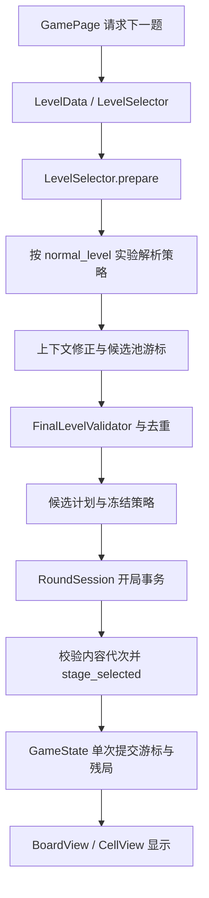

# 1.22.0：从启动到选题、存档和界面

这份导读对应将 1.22.0 完整业务移植到当前公共框架后的工程。旧版 01–06 篇继续作为 1.8.1 的阅读记录；本篇负责连接新版实际代码，先看调用链，再去函数旁读具体说明。

## 从哪个文件开始

根目录 `launcher.tscn` 只有启动节点，脚本是 [products/meowdoku/app/bootstrap/launcher.gd](../../products/meowdoku/app/bootstrap/launcher.gd)。`project.godot` 的 Autoload 会先创建 GameState、UIManager、UniKit、账号与排行等服务。节点进入场景树后，Launcher 的 `_ready()` 负责把这些服务接起来。

启动先检查核心存档是否可用及内容是否要求重启，失败会进入错误页面。正常流程包含：日志与性能时间点、语言和字体实验、闪屏、SDK 与实验默认值、隐私/推送流程、资源预热、账号启动同步，然后进入教程或主页。`_startup_complete` 是软重载流程的门禁，不是“所有网络服务都已成功”的证明。桌面没有原生 SDK 时，保持本地玩法和原有失败回退。

建议第一遍只追 `_ready()` 调用的函数，不展开所有分支。第二遍再看 `_reload_to_target_page` 等账号换号后的页面重建。

## 一道题怎样到达棋盘

主要文件：

| 位置 | 阅读时关注什么 |
| --- | --- |
| `products/meowdoku/gameplay/application/level_data.gd` | 题库条目与玩法参数如何转换，以及不同题库的来源标记 |
| `products/meowdoku/gameplay/application/selection/level_selector.gd` | 冻结实验与时间上下文；只计算候选计划，不直接提交 |
| `selection/strategy/level_selection_strategy.gd` | 策略接口、交付回调、通关结算回调 |
| `selection/strategy/level_selection_strategy_resolver.gd` | 实验值怎样映射到具体策略脚本 |
| `selection/context/` | 尺寸、难关、每日首局、难度层级等上下文修正 |
| `selection/cursor/` | 候选顺序、节奏表、游标推进、预算和重新绑定 |
| `selection/delivery/` | 最终合法性、去重、重试残局和节奏附加字段 |

`selection/` 位于 `products/meowdoku/gameplay/application/`。`LevelSelector.prepare()` 读取候选快照，把时间、随机源、实验值和内容配置固定到 `DokuSelectionRuntime`。策略经 `DokuSelectionState` 修改候选，返回包含 `entry`、前后状态、已读取字段和内容代次的计划。失败只丢弃候选，不需要先修改全局状态再回滚。兼容入口 `select()` 返回的条目携带 `_selection_plan`，调用者必须接入提交链。

`prepare()` 在候选中调用策略的交付回调，构造 retry 参数、预放猫、策略步骤和最近题目记录。`MeowdokuRoundSession` 通过产品端口 `stage_round_selection()` 检查内容代次，再由 `LevelData.stage_selected()` 检查读字段与推荐队列是否冲突，与新局、残局一起提交；提交失败不会消费游标。读到 `_bank_source`、`_puzzle_id`、`_prefill_positions` 时，要把它们当作数据流中的元数据，而不是屏幕控件。

`nl_11xxx_strategy.gd`、`nl_12xxx_strategy.gd` 是多个实验分组并存，不表示要从头到尾依次执行。先确定解析器选中的组，再读该组和父类。策略文件的同名方法可能有不同的放宽顺序、难关规则和副作用。

## 题库现在有三种形态

1. 编辑器中的可读 JSON：`products/meowdoku/assets/editor/levels/`。
2. 运行时紧凑题库：`products/meowdoku/assets/resources/levels/*.bin`，经过二进制编码再 XOR。
3. 运行时 JSON：节奏表等仍使用 JSON，再 XOR。

具体顺序在 `LevelBankIO`：先经 `ContentContext` 解析已验证的更新包逻辑 ID；未注册的内容再读内置库。内置库在编辑器读明文；导出环境先通过 `BankBinaryFormat.runtime_filename()` 判断二进制对应文件，存在时解密并 decode，否则走 JSON 路径。`BankLevelCodec` 在紧凑条目和可读 `regionMap`/`solution` 之间转换；`BankData.materialize_entry()` 负责需要详细字段时展开。

这解释了新版加密插件为什么也要升级：只写出 JSON，可能完全不会影响优先读取的旧 `.bin`。`addons/level_bank_encryptor/bank_file_encoder.gd` 使用同一套编码器，而且在编码前复制数据，避免把编辑器正在使用的字典原地压缩。

原包的 59 个文件里有 37 份二进制、22 份 JSON。65,915 是顶层记录数，包含节奏记录；45,133 是按结构识别的 solution 条目数。不要把两个数都称为“关卡数量”。

## 玩家操作怎样修改状态

`BoardGestureRecognizer`、触点槽位和跨指针双击识别把原始输入整理为手势；`products/meowdoku/gameplay/presentation/input/operations/` 再区分普通点击、滑动和草稿操作。页面把命令交给 `MeowdokuRoundSession`，公共 `RoundService` 调用纯 `DokuRoundModule` 计算候选。库存、动作事实、统计和可恢复残局在同一提交中确认后，页面才接收结果并更新表现。

阅读顺序建议：`products/meowdoku/gameplay/presentation/main/view/game_page.gd` → `base_game_page.gd` → `presentation/input/` → `application/meowdoku_round_session.gd` → `domain/doku_round_module.gd` → `presentation/board/board_view.gd` → `cell_view.gd`。页面和格子显示职责不同：节点动画完成并不自动等于玩法结算，状态变更也不等于立即重建所有节点。

`GameState` 仍是全局状态中心，但新版增加了账号进度、残局、推荐题目、Elo、回流、难度调节、排行和主页陪伴状态。先按函数旁的用途分区看，不需要一次读完所有存取方法。`MeowdokuStore` 描述产品存档结构；`LocalCoreStore` 管理候选校验、schema 迁移和 revision；`SaveStore` 负责原子文件写入与校验。通关、奖励领取、排行和签到在候选内完成，重复回执不重发奖励。原版 `capture_file_snapshot()` / `restore_file_snapshot()` 单文件回滚入口已退役；当前失败候选直接丢弃，不能绕开 revision 恢复文件。普通残局和每日残局仍分别存储，不能混用。

## 实验配置与事件

`AbConfigBase.value()` 的读取顺序是：调试覆盖 → 已读取的远端值 → 默认值。各 `config/*` 子类登记实验键和默认值，再把分组数解释为业务决策。`normal_level` 会改变选题算法；字体、棋盘呈现、提醒等实验改变表现或流程。

`EventBus` 为 `域.动作` 形式的事件名按需注册 Godot 信号。`emit_event()` 同时发具名信号和 `any_event`，后者适合统一观察。`on()` 避免重复连接，`once()` 使用一次性连接，`off()` 解除订阅。这与 Autoload 的直接方法调用并存，不能假设所有跨模块通讯都通过事件总线。

## 新增系统怎样分开读

下表的 `app/`、`gameplay/` 路径均相对 `products/meowdoku/`；`selection/` 相对 `gameplay/application/`。

| 系统 | 入口与边界 |
| --- | --- |
| 账号与同步 | `products/meowdoku/app/platform/auth_manager.gd`、`app/features/account/`、`app/features/data_sync/`；留意登录门禁、冲突选择和本地回退 |
| 排行活动 | `app/features/rank_activity/`、`app/features/robot/`、`app/features/profile/`；区分活动生命周期、排行数据与列表显示 |
| 推荐题目 | `app/features/level_rec/` 与 `selection/provider/server_provider.gd`；追踪请求、缓存、交付及失败回退 |
| 主页陪伴猫 | `app/features/home/home_companion_service.gd`、`app/features/home/core/` 和实验策略；把饱食度/奖励计算与节点动画分开 |
| 特殊玩法 | `app/features/golden_fish/`、`app/features/color_challenge/`、`app/features/peekaboo/`；先找开启条件和残局恢复路径 |
| 虚拟列表 | `scripts/framework/ui/widget/virtual_list*.gd`；观察适配器、布局、复用单元和可见范围，避免把数据条数当节点数 |

## 怎样判断一行是原作还是学习加工

发布包原始 `.gdc` 保留在 `.autoconverted/`。可编辑源码是在反编译、精度修复、格式整理后再添加中文注释。`##` 面向编辑器的脚本/声明文档，`#` 用于函数内部解释与分段。

[当前保真审计](../RECOVERY_FIDELITY_AUDIT.md)明确区分原始回编译证据、布局修复和桌面日志适配。未随包导出的编辑器工具没有猜写为“原版源码”；旧版编辑器生成器已不再被新版引用，因此没有混入新版业务代码。
