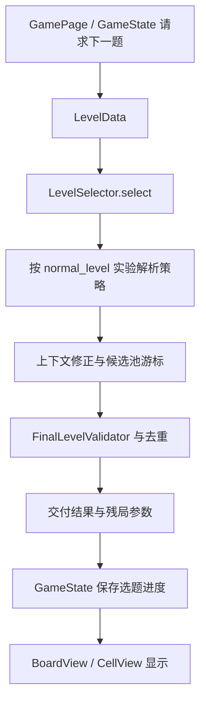

# 1.22.0：从启动到选题、存档和界面

这份导读对应当前恢复工程。旧版 01–06 篇继续作为 1.8.1 的阅读记录；本篇负责连接新版实际代码，先看调用链，再去函数旁读具体说明。

## 从哪个文件开始

根目录 `launcher.tscn` 只有启动节点，脚本是 `scripts/module/ui/panel/launcher.gd`。`project.godot` 的 Autoload 会先创建 GameState、UIManager、UniKit、账号与排行等服务。节点进入场景树后，Launcher 的 `_ready()` 负责把这些服务接起来。

启动流程包含：日志与性能时间点、语言和字体实验、闪屏、SDK 与实验默认值、隐私/推送流程、资源预热、账号启动同步，然后进入教程或主页。`_startup_complete` 是软重载流程的门禁，不是“所有网络服务都已成功”的证明。桌面没有原生 SDK 时，保持本地玩法和原有失败回退。

建议第一遍只追 `_ready()` 调用的函数，不展开所有分支。第二遍再看 `_reload_to_target_page` 等账号换号后的页面重建。

## 一道题怎样到达棋盘

主要文件：

| 位置 | 阅读时关注什么 |
| --- | --- |
| `scripts/module/gameplay/model/level_data.gd` | 题库条目与玩法参数如何转换，以及不同题库的来源标记 |
| `scripts/module/gameplay/selector/level_selector.gd` | 选题前保存进度快照；失败时恢复；成功时统一提交 |
| `selector/strategy/level_selection_strategy.gd` | 策略接口、交付回调、通关结算回调 |
| `selector/strategy/level_selection_strategy_resolver.gd` | 实验值怎样映射到具体策略脚本 |
| `selector/context/` | 尺寸、难关、每日首局、难度层级等上下文修正 |
| `selector/cursor/` | 候选顺序、节奏表、游标推进、预算和重新绑定 |
| `selector/delivery/` | 最终合法性、去重、重试残局和节奏附加字段 |

`LevelSelector.select()` 先保存 `GameState.get_level_selection_progress_snapshot()`，然后把 `LevelSelectRequest` 交给策略。策略内部返回包含 `entry` 的交付结果；选择失败时调用 `_fail_and_restore()`，避免只推进游标却没拿到题。

`_finalize()` 会调用策略的交付回调，构造 retry 参数、预放猫和策略步骤信息，写入最近题目记录，再返回棋盘需要的条目。读到 `_bank_source`、`_puzzle_id`、`_prefill_positions` 时，要把它们当作数据流中的元数据，而不是屏幕控件。

`nl_11xxx_strategy.gd`、`nl_12xxx_strategy.gd` 是多个实验分组并存，不表示要从头到尾依次执行。先确定解析器选中的组，再读该组和父类。策略文件的同名方法可能有不同的放宽顺序、难关规则和副作用。

## 题库现在有三种形态

1. 编辑器中的可读 JSON：`assets/editor/levels/`。
2. 运行时紧凑题库：`assets/resources/levels/*.bin`，经过二进制编码再 XOR。
3. 运行时 JSON：节奏表等仍使用 JSON，再 XOR。

具体顺序在 `LevelBankIO`：编辑器读明文；导出环境先通过 `BankBinaryFormat.runtime_filename()` 判断二进制对应文件，存在时解密并 decode，否则走 JSON 路径。`BankLevelCodec` 在紧凑条目和可读 `regionMap`/`solution` 之间转换；`BankData.materialize_entry()` 负责需要详细字段时展开。

这解释了新版加密插件为什么也要升级：只写出 JSON，可能完全不会影响优先读取的旧 `.bin`。`addons/level_bank_encryptor/bank_file_encoder.gd` 使用同一套编码器，而且在编码前复制数据，避免把编辑器正在使用的字典原地压缩。

原包的 59 个文件里有 37 份二进制、22 份 JSON。65,915 是顶层记录数，包含节奏记录；45,133 是按结构识别的 solution 条目数。不要把两个数都称为“关卡数量”。

## 玩家操作怎样修改状态

`BoardGestureRecognizer`、触点槽位和跨指针双击识别把原始输入整理为手势；`game/input/operations/` 再区分普通点击、滑动和草稿操作。页面负责把操作送到玩法状态，并更新提示、音效、统计和存档。

阅读顺序建议：`game/view/game_page.gd` → `base_game_page.gd` → `game/input/` → `gameplay/view/board_view.gd` → `cell_view.gd`。页面和格子显示职责不同：节点动画完成并不自动等于玩法结算，状态变更也不等于立即重建所有节点。

`GameState` 仍是全局状态中心，但新版增加了账号进度、残局、推荐题目、Elo、回流、难度调节、排行和主页陪伴状态。先按函数旁的用途分区看，不需要一次读完所有存取方法。`SaveStore` 负责具体落盘；选题进度快照、普通残局和每日残局需要分别理解。

## 实验配置与事件

`AbConfigBase.value()` 的读取顺序是：调试覆盖 → 已读取的远端值 → 默认值。各 `config/*` 子类登记实验键和默认值，再把分组数解释为业务决策。`normal_level` 会改变选题算法；字体、棋盘呈现、提醒等实验改变表现或流程。

`EventBus` 为 `域.动作` 形式的事件名按需注册 Godot 信号。`emit_event()` 同时发具名信号和 `any_event`，后者适合统一观察。`on()` 避免重复连接，`once()` 使用一次性连接，`off()` 解除订阅。这与 Autoload 的直接方法调用并存，不能假设所有跨模块通讯都通过事件总线。

## 新增系统怎样分开读

| 系统 | 入口与边界 |
| --- | --- |
| 账号与同步 | `scripts/common/auth_manager.gd`、`module/account/`、`module/data_sync/`；留意登录门禁、冲突选择和本地回退 |
| 排行活动 | `module/rank_activity/`、`module/robot/`、`module/profile/`；区分活动生命周期、排行数据与列表显示 |
| 推荐题目 | `module/level_rec/` 与 `selector/provider/server_provider.gd`；追踪请求、缓存、交付及失败回退 |
| 主页陪伴猫 | `module/home/home_companion_service.gd`、`home/core/` 和实验策略；把饱食度/奖励计算与节点动画分开 |
| 特殊玩法 | `module/golden_fish/`、`module/color_challenge/`、`module/peekaboo/`；先找开启条件和残局恢复路径 |
| 虚拟列表 | `module/ui/widget/virtual_list*.gd`；观察适配器、布局、复用单元和可见范围，避免把数据条数当节点数 |

## 怎样判断一行是原作还是学习加工

发布包原始 `.gdc` 保留在 `.autoconverted/`。可编辑源码是在反编译、精度修复、格式整理后再添加中文注释。`##` 面向编辑器的脚本/声明文档，`#` 用于函数内部解释与分段。

[当前保真审计](../RECOVERY_FIDELITY_AUDIT.md)明确区分原始回编译证据、布局修复和桌面日志适配。未随包导出的编辑器工具没有猜写为“原版源码”；旧版编辑器生成器已不再被新版引用，因此没有混入新版业务代码。
