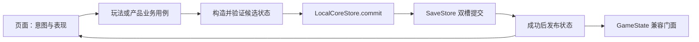

# 本地业务、事务与存档

这份文档描述当前已经接入的实现，不把以后可能增加的服务当作已有能力。

## 数据怎样流动



业务动作通过普通函数调用完成，不需要启动本地 HTTP 服务。`LocalCoreStore` 是同进程的单写入入口，`EconomyService` 处理库存和奖励，`RoundService` 处理不同玩法的命名空间、动作序号及模块状态。网络服务器、远程鉴权和跨设备同步没有因为这样的分层而自动实现。

`GameState` 暂时保留旧页面使用的 getter 和字段。它把核心快照投影到这些字段，减少一次性迁移所有页面的风险；新的用例构造候选状态后提交，页面不能通过修改读取到的字典来绕过事务。

## 文件与数据结构

新核心档使用 `user://save_store/core_a.cfg`、`core_b.cfg`。`core_flag.txt` 只是兼容提示，不是选择新档的依据。两个槽都包含文件格式号和递增的 `revision`；读取时选择最高完整 revision。

业务 envelope 包含 `schema_version = 1` 和 `state`。`state` 的主要字段如下：

| 字段 | 内容与归属 |
|---|---|
| `product` | 当前为 `meowdoku`，防止读错产品状态 |
| `profile` | 旧玩家进度、DDA 累计值、设置、统计、广告补偿队列；库存和残局已移出 |
| `inventory` | 道具名到非负整数的映射；本产品为 locate、hint、undo |
| `endgame` | 旧页面恢复用的 `snapshot` 和统计 `stats` |
| `features.streak` | 签到日期、周期、分组及切组礼包身份 |
| `award_sequence` | 持久奖励发号水位；重启和全量重置均不重复使用旧编号 |
| `pending_awards` | 已获得资格、尚未完成入账的奖励，包含固定条目与翻倍标记 |
| `claims` | 稳定业务身份到奖励编号的映射；无奖励签到使用 0 |
| `round_services` | 按玩法/模式隔离的活动对局，例如 doku/main、doku/daily、doku/preview |
| `round_runtime` | 当前主线的 dirty、retry、道具/复活、待降档等 DDA 标记 |
| `product_settlements` | 各模式当前局最后一次尝试的结算水位，以及旧完整残局的单个兼容水位 |
| `migration` | 是否导入过旧业务文件的信息 |

`profile` 保留旧设置字段是兼容选择，不是框架要求所有配置、下载缓存、日志和大资源进入一个文件。文件存储后端可以调整，必须维持业务提交的语义。

## 什么时候会写盘

`GameState._save_data()` 和 `_save_endgame()` 都经过同一个核心存档。旧玩家文件、旧残局文件和旧签到文件不再接受新业务的双写。

- `set_tool_count()` 返回 bool；保存成功后才通知库存变化。
- 新的道具用例把库存变化、模块快照和对应旧残局一起提交。
- 奖励整笔入账时，一次提交所有道具变化及 pending 移除。
- 签到日期/领取资格和奖励登记在同一次提交中完成。
- 切组状态和礼包资格一起登记，关闭弹窗只领取既有奖励。
- 广告补偿领取时，队列移除、每日额度和道具入账一起提交。
- 结算时，计局、DDA、进度、相关残局清理和结算水位一起提交。
- 部分旧统计仍采用短时间合并写盘；`GameState.get_core_candidate()` 将这些尚未合并的字段纳入新业务候选。

已登记但尚未合并的统计另有一份内存快照。无关设置、棋盘或重置候选保存失败时，只恢复这些已接收统计；失败候选的设置与棋盘仍恢复到权威存档。独立库存提交也不会覆盖待合并统计。自有提交成功时，先清理本次已提交的待合并数据，再发公开库存通知；监听者在同步通知中登记的新统计继续等待下一次保存，外层返回不会再次清空它们。它们在成功落盘之前仍不是持久数据。

库存通知也允许观察者同步提交：按字段记录已经发布的余额；嵌套提交产生新 revision 后接管剩余通知，外层停止发送旧快照，避免重复或过期余额通知。

`_own_core_commit` 只标记本次提交是否包含 GameState 尚未合并的成员字段；核心的同步 `committed` 回调在发布公开通知前消费这个标记，因此通知中的嵌套提交有自己的归属。它不是锁，也不表示事件发起页面。当前成员编码用 `MeowdokuStore.capture_profile()` 提取 profile/inventory；一次性旧档迁移才使用 `from_legacy()`。字段默认值和旧接口仍显式保留，不以反射式字段平台替换现有存档合同。

新增玩家字段时仍需同步默认值、类型与映射。偏好回归会检查编码键与 `PROFILE_TYPES` 一致，并用非默认候选验证 profile、inventory、endgame 和待领取奖励的往返与重置；残局和分玩法统计的旧 ConfigFile 空槽位不等于数据丢失，它们通过独立分区保存。

设置入口返回保存是否成功。音乐、音效、震动、人声和语言只有在成功后才更新对应界面和平台状态；失败提示重试，缓存设置页重新显示时从已保存状态刷新。

主线新题在搭盘成功后，一次提交选题游标、每日降档资格、重试题面、初始检查点及自动标叉设置。准备失败、保存失败或布局等待中退出，不提前清掉有效旧题；关闭残局保存的新题明确清掉旧检查点。恢复/缓存续玩不推进题库游标，只提交必要的入场状态；恢复保留本局 dirty 标记和已冻结策略。新主线的埋点 ID 与对应统计清零也在这次候选中提交。`Tracker.create_game_id()` 只生成身份，成功后 `accept_game_start()` 才从 GameState 接收已提交的身份和统计；失败不会提前发布新局。

每日挑战在第二次布局完成且页面代次仍有效时提交入场：NEW 的日期、新 ID、统计清零与自动标叉策略一起保存；CONTINUE/RESTART 保留既有 ID 和统计。内容错误、布局等待中退出或写失败不会提前将首次入场变成继续入场。这不表示整个 on_show 的界面、声音或 SDK 副作用都属于文件事务。

主线与每日共享明确的入场就绪条件：准备、失败、隐藏和销毁时不可操作，题面准备及必要提交成功后才开放。业务动作入口和实际输入入口都检查它；按钮透明、动画完成或缓存中仍有旧棋盘，不代表新局可以消费库存。提交回调中同步离开页面，也不会由旧入场流程重新开放操作。

广告补发首次登记返回保存结果，watchdog 只在登记成功或已登记后消费。写失败保留来源，由一个 30 秒重试计时器限频处理，回前台也可重试；正常领奖历史使用同一待写出口。未超时的广告不会提前补发，晚到的正常奖励可取消尚未登记的补发，清档会取消旧待写事件与计时器。此机制保障同进程重试；持续写失败后进程被杀，仍不能凭空恢复尚未持久化的广告凭证。

每日自动标叉的免费资格和当日权益也在同次候选提交。免费资格沿用原产品规则，不因日切重新赠送；广告已回奖但写盘失败时，缓存弹窗保留当日重试意图，SDK close 不会代替成功保存。教程结束同样先保存完成标记，失败留在结束确认，成功才进入首局。

表现层在成功之后播放到账动画、发成功事件。SDK 埋点可以发生在业务成功之后，但它不属于本地文件事务。结束参数构造是只读操作；`Tracker.track_game_end()` 只在业务成功后累计 `time_total`，继续使用原有合并写盘，避免保存失败重试反复累加。

`capture_profile()` 在 ConfigFile 编码边界深拷贝嵌套容器。候选的奖励资格、题库进度、统计或重试题面不再共享 GameState 活字段：即使一笔批量领取先暂存第一项、随后因资格失效或库存溢出早退，丢弃候选即可，不会被下一次无关保存带入正式存档。主线/LK 进度及重试题面的 getter 返回副本；查询缺失进度不创建活数据，修改通过对应 setter 明确交回。

## 关键接口

道具计费沿用原版的区别：每次成功重新打开提示都计费，应用当前提示不再扣费；定位按使用次数计费，即使没有候选也消费，但不制造落猫或步历史。撤销没有可选步骤时不收费；选中了可编辑步骤，即使格值已等于历史原值，也消费并移除该段历史。普通关没有提示方案时不扣提示，SP关沿用定位降级。现有免费策略、库存不足时的广告补充、入场/终局保护及存储失败不扣费保持有效。

主动重新打开与重试同一请求不同：前者使用新的序号并重新计费，后者继续返回已提交回执，不能重复扣费。存档里的提示凭证保证扣费和应用一致，不再代表关闭后免费复看的权益。

```gdscript
var candidate: Dictionary = GameState.get_core_candidate()
var revision: int = GameState.get_core_store().revision()
# 在候选中修改本动作涉及的字段，先验证业务条件。
var result: Dictionary = GameState.commit_core_candidate(candidate, revision)
if result.get("ok", false):
    # 此处才发布对应的表现。
    pass
```

在当前 Meowdoku 页面过渡期间，`RoundService` 使用产品适配端口：

- `snapshot()` → `GameState.get_core_candidate()`，包含尚未合并的旧统计。
- `revision()` → 核心 revision。
- `commit()` → `GameState.commit_core_candidate()`。

独立玩法测试可以直接使用 `LocalCoreStore`。它提供 `open()`、`is_open()`、`snapshot()`、`revision()`、`commit()` 和成功后的 `committed(revision)` 信号。`snapshot()` 返回深拷贝；候选禁止包含 Node、Resource、Callable、Signal 或 RID 等运行时引用。

`open(initial_state)` 只有在文件确实不存在时才接受初始状态，而且本身不把默认值写盘。损坏、未知文件格式、未知业务 schema 和状态验证失败是不同的错误，不能当作首次安装。

## 提交与失败的界限

文件提交顺序为：

1. 检查当前完整 revision，并验证调用方的 `expected_revision`。
2. 写另一个槽的临时文件。
3. 回读并核对内容。
4. rename 到正式槽；这是本协议的提交点。
5. 尝试更新兼容 flag。
6. 更新内存中的核心状态并发出成功信号。

flag 更新失败后，正式槽仍是已提交状态；新读取器会根据 revision 找到它，不能再向业务层宣称“整笔没有提交”。提交点之前失败则不发布候选状态，原槽仍可读取。

`SaveStore.last_result()` 表示最近完成的公开读取或提交结果，包括空配置、忙碌、路径错误、版本冲突等提前返回；内部扫槽不覆盖这份诊断。调用者仍应优先处理本次调用直接返回的结果。

这些保证针对单进程、同步单写者的完整提交与恢复。不等于操作系统掉电后绝不丢失最近已确认数据，也不支持两个进程同时修改同一对槽。当前实现是同步整份保存，后续如果文件规模增长，应在目标设备测量耗时，再决定分区或写入调度。

`GameState` 的失败结果可通过返回值和 `storage_failed` 观察。新档不能打开时，`is_storage_ready()` 为 false；业务入口拒绝继续写，启动流程应显示恢复错误，不能把默认画面当成一个已经成功初始化的新玩家。

## 奖励为何不会因为重试重复到账

奖励分成两个事实：已经获得领取资格，和已经入账。

`EconomyService.register_award()` 持久分配 uid 并登记 pending。调用方如果有稳定业务身份，应传同一个 `claim_key` 重试。`stage_award()` 可以把登记加入其他业务的候选状态，例如签到资格变化。

`claim_award(uid)` 在一个候选中增加全部库存并移除 pending。对于已经分配、但已不在 pending 中的 uid，重复领取返回 `already_applied`，不会再次增加库存。这样无需无限保存每一个已发奖励的详细流水。

`double_award(uid)` 在奖励仍未结束时持久化翻倍资格。它不能在基础奖励结束之后随意修改已完成事实。若产品以后支持非常迟到的广告追加奖励，应根据独立外部凭证创建补充奖励。

奖励页的领取按钮先提交入账，成功后才关闭。收到翻倍回调却写盘失败时，本次页面保留翻倍意图供重试，不让紧随其后的广告关闭回调把它降成普通领取；这不替代跨进程可恢复的 SDK 凭证。

`claims` 中的业务资格记录没有随意按“最后 N 条”裁剪；是否能删除，需要证明对应旧请求之后会被其他资格条件拒绝。跨重启稳定的奖励 uid 不再使用原来只在内存中自增的 `GlobalUniqueId`。

## 对局、复活与有界结算

同一谜题可以经历“死亡、复活、再胜利”。因此结算身份是 `round_id + /attempt#N`，不能把整局第一次失败与复活后的胜利当成重复结果。

当前接口：

```gdscript
GameState.settle_main_round(attempt_id, level, "win", runtime_snapshot)
GameState.settle_main_round(attempt_id, level, "fail", runtime_snapshot, retry_params)
GameState.settle_daily_round(attempt_id, date, "win", elapsed_sec, beat_percent, runtime_snapshot)
GameState.settle_preview_round(attempt_id, "quit", runtime_snapshot)
```

这些页面入口只负责装配请求。实际事务由 `products/meowdoku/gameplay/application/meowdoku_round_settlement.gd` 的 `MeowdokuRoundSettlement` 处理：命名工厂区分 main、daily、preview 和旧残局，避免内部传递一长串位置参数。`stage()` 按顺序检查身份、验证盘面、更新进度、处理奖励和登记回执，不访问 GameState、页面或 SDK。

`stage(candidate, economy, today, dda_policy)` 接受已校验核心状态的独立候选，以及显式日期和策略。主线策略先从请求的 `saved_dda_policy(candidate)` 取得；旧档缺失时由门面补当前策略。stage 允许修改候选后发现失败，因此任何失败结果都必须丢弃候选；成功但 `duplicate=true` 则直接返回，不提交、不通知。只有成功的新结算才由 GameState 提交一次，然后更新会话字段和埋点。`test_product_settlement.gd` 直接调用这条产品事务，不使用页面或 GameState；真实页面和写失败仍由集成测试验证。

每次先确认 host 中仍然是对应模式的同一局，再检查已有收据；因此胜利后 host 已经关闭，同一次重试仍能返回 duplicate。新结算只接受活动局中实际记录的尝试序号。相同尝试却改成另一个结果会被拒绝。旧局、旧尝试、重置后的旧回调和跳号也会被拒绝。

`runtime_snapshot` 包含当前棋盘、生命、撤销历史和高亮游标，由 Doku 模块验证后与产品结算一起提交。胜利必须由 Doku 模块验证盘面完成，不能只信页面传入 win。失败同次保存零生命和重试题面；胜利或退出同次将 host 标记为 settled。固定关卡奖励从已保存的 level_definition 读取，与通关进度同次入账，不重读当前远端表。复活通过模块动作提交生命和 `attempt_sequence + 1`，成功后页面才恢复表现。终身一次的免费复活资格也在同一候选中校验并消耗，失败页不提前写标记。调用方不能只换一个尝试编号来绕过失败结果。

每个模式只需保留当前局最后一次尝试。安全来自 host 的单调 `start_sequence` 和活动局身份检查，不是因为“旧收据大概不会再来”。

全量重置成功后同时清理会话胜场/广告计数、冷启动已胜标记、首次降档评估等本对象运行时缓存；失败保持原值。全量重置会保留每个命名空间的 start_sequence，将旧 record 标记为 reset，并清除其动作结果。下一局必须使用更大的序号，避免旧回调与重置后的第一局撞号。

主线结算会清除它的残局。每日挑战和题库预览有独立命名空间，它们的结算不清除停放的主线残局，也不推进主线 DDA。每日胜利另保存日期、耗时、成绩和历史最佳。

主线/每日胜负结算保存失败会暂停操作并显示确认弹窗，可重试保存或明确返回主页。弹窗绑定本次业务代次，离开后旧回调失效；连续失败仍有可点击的重试入口。主线首次终局时间和每日首次耗时/成绩在重试期间冻结；复活成功恢复计时。

通关与连胜签到分别提交。`notify_win()` 返回签到结果；通关成功而签到失败时，玩家可以单独重试或跳过本次签到，不会重放通关进度。打卡候选自行重算断签，避免依赖此前清零保存成功；后台日切失败冷却30秒再试，主动打卡不受冷却限制。切组提示消费失败保留资格，礼包领取失败留页重试。

每日挑战保留产品原有重开行为：关闭后重新进入创建新局，重置盘面、生命和计时，不接续上一局的付费提示。它不具备主线的残局恢复语义；这也不等于同一请求会重复扣费。对应生命周期回归同时验证了两次进入的局号和消费边界。

页面的异步展示属于当次进入：布局、广告后入场、打卡延迟、引导等待等恢复执行时要检查页面代次和关闭状态。UIManager 另外使用显示序号区分同一缓存窗口的多轮显示/关闭，避免旧动画或 on_hide 收尾影响新窗口；预热和同步显示共用同一实例。两层标识各自管理业务局和窗口生命周期，不互相替代。补发弹窗另外区分每批奖励，旧领取/关闭动画不能结束新批次；首页等待结束后同时移除 collected/closed 的互斥监听，外部隐藏不丢未领取资格。窗口 on_show 同步关闭时不发布孤立的 hidden/shown；只有已发布 shown 的窗口才发布其 hidden。

`MeowdokuSettlementRules` 是纯数据实现，保留了原主线 DDA 的判定顺序。新局采用保存的 gameplay_policy.dda，恢复后不因当前 AB 变化重算当局结算策略；没有快照的旧记录使用兼容策略。旧进度入口也复用同一规则。

普通手势检查点会合并保存。失败时保持当前活棋盘，提示一次并最多重试三次（1/2/3 秒）；重试重新捕获最新棋盘，不能将旧失败副本覆盖后续编辑。页面隐藏时最后尝试保存，旧代次 deferred 回调被忽略。持续写失败时只能恢复最后一次成功检查点，不承诺尚未落盘的操作已经持久化。

旧存档中已经填完但尚未推进的残局走 `settle_legacy_completed_main(level)`：只接受没有新业务局号、且与当前关匹配的完整持久快照。它推进进度并清快照，不猜测旧版计局是否已经写过，因此不额外增加计局。

## 迁移和回退

只有 `core_a/core_b` 确实不存在时，才读取旧玩家档、旧残局和 `streak.cfg`，验证字段并一次提交为新核心档。旧文件保留原样；迁移失败不会删除它们，也不会假装完成。

新核心一旦存在，后续启动从新核心读取，不会因为旧文件还在就重新导入旧奖励。新核心损坏或 schema 不兼容时，不自动回退到旧玩家文件或覆盖为默认档。

内容版本回退不应恢复整份旧玩家备份。资源加载失败和库存/领取资格是不同的问题，不能为了回退资源而抹掉玩家之后获得的道具。

这里没有实现旧客户端与新客户端来回运行后的存档合并。需要支持应用降级时，应另行明确 schema 兼容与数据分叉策略。

## 原生 SDK 的边界

激励广告以 `show_id` 关联一次展示，业务先调用 `connect_reward_once(show_id, callback)`，再调用 `show_reward()`；隐藏/销毁时通过 `disconnect_reward_callbacks(self)` 撤销页面消费者。正常迟到回奖只交给原次消费者，取消对应尚未登记的 watchdog；不能根据时间、队列顺序或当前页面猜测归属。已登记补发的同一次广告不再重复正常发奖。保留的单参数 `ad_rewarded(placement_id)` 只供观察当前展示，业务领取不应再监听它。

“当前没有广告正在展示”不表示“此前所有广告都已回奖”。道具页面在同一业务代次内可以保留多个未完成的 `show_id`：请求 B 不取消 A，两个合法奖励分别到账，重复 ID 仍只交付一次。页面被其他窗口遮挡时仍处于同一生命周期；真正隐藏、销毁或重新进入新业务代次才撤销旧消费者。回调也检查代次和生命周期，防止已经取出的旧 Callable 作用于复用后的页面。

复活是一次失败的权益。主线和每日共用一个局部处理入口，以页面代次和失败尝试序号约束它的有效期：提交中的回奖先保存各自上下文，只有当前提交失败后才依次用于重试；成功后结束该次权益并撤销其余请求。已经到达的多笔回奖不会相互嵌套执行复活，也不会因忙碌被直接丢弃。所有已到达的自动重试都失败时保留失败页，只报告最终失败，不自行无限重试。

失败页在广告回奖后保留本次展示的一次待兑现资格，按钮改为已有本地化“重试”文案并隐藏广告标志。玩家可直接重试保存，不再要求重看广告；再次写失败继续保留，成功、主动离页、销毁或新展示结束该资格，不能带到下一次失败。它是当前进程内的恢复能力，不是持续写失败后杀进程仍可恢复的外部凭证。

成功提交后先同步活页面的生命、尝试序号和完成状态，再累计统计、关闭失败页和播放演出；同步关闭回调因此看不到过期的死亡状态。隐藏、销毁或重新进入会作废旧队列，旧调用返回时不能清除新代次的请求。每日复活和道具领奖都允许页面暂时被遮挡，仍要求业务入场成功、代次有效且未关闭；输入和演出的可见性规则保持独立。每日自动标叉和礼包领取保持各自已有的结束规则，不因为道具可累计就改成重复生效。

`MeowdokuRoundSession` 另外保证同一局的下一请求序号不会被旧回执倒退，包括序号耗尽的终态。原调用仍取得自己的回执；这不是所有业务调用整体串行的承诺。复活的一次性语义由上述同次失败的串行处理保证，单独保护序号并不足以防止重复复活。

奖励消费者和广告时长观察者的生命周期不同。清理奖励回调不应顺带断开所有属于页面的 `ad_closed` 监听；每日页面的常驻监听需要跨缓存重开保留，才能继续扣除广告观看时间。主线临时入场等待则由对应流程显式取消。

原生桥必须把传入 `showAd(placement, position, show_id)` 的身份原样带回以下信号，所有参数均为 `String`：

- `ad_shown_for_show(placement, show_id)`
- `ad_rewarded_for_show(placement, show_id)`
- `ad_closed_for_show(placement, show_id)`
- `ad_error_for_show(placement, show_id, message)`

只有旧 placement 回调的桥，激励广告的 readiness/valid/show 均保守返回不可用；原有插屏接口继续保留。仓库 Mock 和直接领奖路径已接入相同身份流程。这里声明的是待原生侧适配的接入合同，仓库不包含已实现这四个信号的原生插件，不能将桌面通过视为 SDK 验收通过。

逐次身份解决回调错配，不等于跨进程可靠交付。页面已经离开、奖励已经普通领取或当次权益已经结束时，仍遵循各页面现有业务规则；本次没有建立任意迟到奖励追加或外部持久凭证系统。保存持续失败后杀进程的内存事件也仍无法恢复。实际 SDK 的奖励/关闭顺序和进程重启行为需要按上述合同在目标平台验证。

广告补偿入口会重新校验待补偿队列、每日资格及来源对应奖励。它解决的是本地“发了道具但没移除资格”等半完成问题。付费验证、防作弊、可信时间和跨设备一致性仍需要各自的外部能力。

## 怎样验证

在项目根目录执行：

```sh
python3 tools/run_validation.py --script res://tools/validation/test_storage.gd
python3 tools/run_validation.py --script res://tools/validation/test_storage_business.gd
python3 tools/run_validation.py --script res://tools/validation/test_storage_award_page.gd
```

运行器复制工程到临时目录并重定向业务存档，测试不使用日常玩家存档。文件层测试覆盖旧格式、过期/丢失 flag、临时写入中断、替换前失败、坏槽恢复、未知 schema、版本冲突和引用隔离。业务测试覆盖旧档迁移、奖励重试、签到/切组/补偿事务、真实 GameState 门面、结算失败、复活尝试身份及重置后的局号水位。

奖励页测试通过真实 UIManager、场景和按钮信号验证保存失败留页、成功重试关闭，以及翻倍回调保存失败后，SDK close 不降成普通领取。广告回调在隔离进程中通过现有信号模拟，不启动原生广告。文件存储、产品业务、奖励页分别为100、105、19项断言，候选隔离另有65项；独立无 Autoload 会话36项、结算15项，共51项通过。另有567项真实页面广告检查，覆盖连续回奖、同次失败复活串行、全部自动重试失败后的免广告手动重试、后续动作及生命周期边界；数量不等于穷尽所有时序。原版道具计费边界另有67项，主线/每日提示关闭重开的实际游戏用例扩展至52项。

复活故障测试按候选中的新增 `revive` 回执识别目标提交，检查实际失败次数，不再猜测“这是第几次写盘”。新增恢复提示用 Godot 原生 PO 与翻译键，保留原始75份翻译；语言覆盖、真实失败界面及导出加载都有验证，译文和字体仍需要人工验收。

故障注入案例会故意产生保存失败或坏文件的诊断；通过条件是断言和脚本检查成功，而不是假定所有日志都应该为空。
